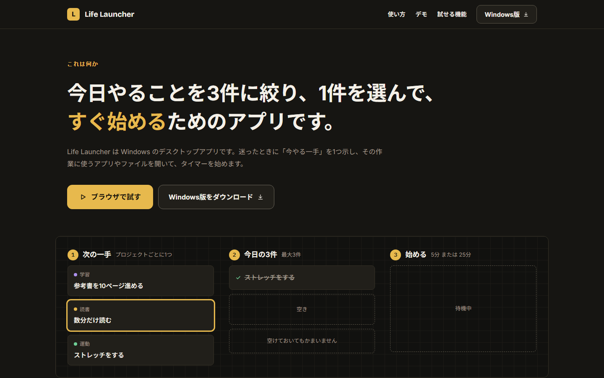

# Life Launcher Web Demo

「何をしよう？」を「今これをやる」に変える、Windows 向け個人用実行支援アプリ **Life Launcher** のインタラクティブ Web Demo です。

- **[Live Demo をブラウザで試す](https://life-launcher-web.takuyakou.workers.dev/)**
- [Windows 版をダウンロード](https://github.com/Takuyakou/life-launcher/releases/latest) ・ [Life Launcher 本体リポジトリ](https://github.com/Takuyakou/life-launcher)



---

## この Web Demo で体験できること

サンプルデータを使って、Life Launcher の「決めて、選んで、すぐ始める」流れをブラウザ上でそのまま試せます。

1. **今日の勝利条件と「今やる一手」**
   - 「今日の勝利条件」を編集・達成でき、プロジェクト色に沿った「今やる一手」が 1 件表示されます。
   - `今日の 3 件` に入っている未完了の一手を優先表示し、「次はここから」の再開メモの確認や、「他の一手」による切り替えができます。
2. **「今日やるものを選ぶ」と今日の 3 件**
   - プロジェクトで絞り込みながら最大 3 件を選び、その場でやりたいことを足して順番を入れ替え、「決定」でまとめて保存します（未保存のまま閉じる場合は破棄確認が出ます）。
   - 実行中・一時停止中・満了確認待ちの項目は保護されて外れません。不要になった項目は、元の候補や実行記録を残したまま「今日の3件から外す」で採用だけを解除できます。
3. **タイマー実行・延長・次の一手の更新**
   - 5 分 / 25 分タイマーの開始・一時停止・再開・終了を行えます。Demo 用の「短時間分まで進める」「満了まで進める」を使えば待たずに終了フローを確認できます。
   - 予定時間が来ると「予定時間になりました」から 1〜240 分（±5 分）の延長、または「次はここから」と次の一手を残して「今日の実行」への記録を選べます。3 件すべて完了すると次の 3 件へ進めます。
4. **「まとめて取り込む」（体験版）**
   - AI に提案させたプロジェクト・次の一手・やりたいことの JSON 回答（または画面内のサンプル回答）を貼り付けると、ブラウザ内だけで解析して選んだ行を追加できます。
   - 取り込み直後は 5 秒間の「元に戻す」通知から取り消せます。
5. **辞書検索・リセット**
   - 辞書の絞り込み・起動演出や、状態リセット（初期サンプルの学習・運動・読書への復元）を試せます。

---

## Windows 版との違い・Web Demo の制約

※ この Web Demo は体験版であり、Windows 製品版の完全移植ではありません。

- **起動動作と機能範囲**: アプリ・ファイル・URL の起動は画面上の演出のみです（Windows 版では実際に開きます）。手順書ビューア、記録画面、設定画面の完全版、表示サイズ（大・特大）、ミニタイマー、拡大タイマー、複数ディスプレイ対応、ZIP バックアップ、D&D 並べ替え、および Windows 版固有の優先順ロジック（長く空いたプロジェクト等）は含みません。
- **保存先と取り込み範囲**: 入力・選択・候補の除外・実行記録・開閉状態はすべて**このブラウザの中に保存します**。サーバー送信・アクセス解析・ログインは行いません。保存に失敗した場合は変更を反映せず変更前の状態を保ちます。「まとめて取り込む」は外部 AI への送信を行わずブラウザ内だけで読み取り、プロジェクトとやりたいことだけを追加します（きっかけやタイマー分数はプレビューに注記のうえ反映しません）。
- **日付とタイマーの再読み込み挙動**: 今日の 3 件と除外状態は**日付が変わっても自動ではリセットされません**（解除・次の選択・リセットで切り替えます）。進行中・一時停止中・満了未確定のタイマーは、ページを再読み込みすると待機状態へ戻ります。途中終了も実行記録に残りますが、今日の 3 件の完了扱いにはなりません。

---

## 開発・自動検証

React 18 / TypeScript / Vite で構築しています。見出しの英字には Bricolage Grotesque（SIL Open Font License 1.1、`src/assets/fonts/OFL.txt`）を同梱しています。

```powershell
npm.cmd ci
npm.cmd run dev
```

自動検証（E2E / Visual QA はビルド済み `dist` を本番同等の CSP で検証するため、`WEB11_PREVIEW=1` 実行前に開発サーバーを停止してください）:

```powershell
npm.cmd run public:check
npm.cmd run lint
npm.cmd run test
npm.cmd run build
$env:WEB11_PREVIEW = "1"
npm.cmd run test:e2e
npm.cmd run test:visual
```

各バージョンの仕様差分・リリースゲート記録は [docs](docs/README.md) にまとめています。

---

## 配信・プライバシー

- **公開先**: [life-launcher-web.takuyakou.workers.dev](https://life-launcher-web.takuyakou.workers.dev/)
- **ホスティング**: Cloudflare Workers + Static Assets（`npm run build` → `dist`）。`main` へのマージ後、Git 連携で自動ビルド・本番反映されます（Wrangler 設定ファイルはリポジトリ外で管理）。
- **外部通信なし**: アプリ用のバックエンド・データベース・認証・アクセス解析は一切使用していません。

---

## 利用条件

Source available for viewing. All rights reserved unless otherwise stated.
